# Баг-репорти Спринту 3 — «Персонал+» (Run 1)

> **Дисципліна:** «Технології забезпечення якості програмних засобів» (ТЗЯПЗ)  
> **Шаблон:** §4.11 методички; той самий шаблон — [`.github/ISSUE_TEMPLATE/bug_report.md`](../.github/ISSUE_TEMPLATE/bug_report.md)  
> **Трекер:** GitHub Issues репозиторію, мітка `sprint:3` (кожен звіт нижче продубльовано issue з тим самим Bug ID у заголовку)  
> **Звітів:** 12 (норматив ≥ 8) · severity: Major — 6 · Normal — 2 · Minor — 3 · Trivial — 1 · priority: P3 — 12  
> **Рецензування:** 100 % звітів, рецензент Коломоєць О. (СМ), 28.10.2026, за 7 правилами §5.3

---

## 1. Зведення

| Bug ID | Issue | Заголовок | Severity | Priority | TC | Вимога | Автор |
| :-: | :-: | :--- | :-: | :-: | :-: | :-: | :--- |
| [BUG-001](#bug-001) | [#23](https://github.com/white-cod/Software-Quality-Assurance-Technologies_Stuff-Plus/issues/23) | Поля Username і Password на сторінці входу не позначені зірочкою «*» | Minor | P3 | TC-005 | GUI-40 | Любочка В. |
| [BUG-002](#bug-002) | [#24](https://github.com/white-cod/Software-Quality-Assurance-Technologies_Stuff-Plus/issues/24) | Сесія не завершується після 16 хв бездіяльності — сторінки відкриваються без повторного входу | Major | P3 | TC-008 | S-20 | Любочка В. |
| [BUG-003](#bug-003) | [#25](https://github.com/white-cod/Software-Quality-Assurance-Technologies_Stuff-Plus/issues/25) | Пароль із 7 символів приймається під час створення користувача — немає «Should have at least 8 characters» | Major | P3 | TC-014 | GUI-50, S-10 | Любочка В. |
| [BUG-004](#bug-004) | [#26](https://github.com/white-cod/Software-Quality-Assurance-Technologies_Stuff-Plus/issues/26) | Пароль без великої латинської літери приймається, індикатор показує «Strong» | Major | P3 | TC-015 | GUI-50, S-10 | Любочка В. |
| [BUG-005](#bug-005) | [#27](https://github.com/white-cod/Software-Quality-Assurance-Technologies_Stuff-Plus/issues/27) | Пароль без спеціального символу приймається під час створення користувача | Major | P3 | TC-016 | GUI-50, S-10 | Любочка В. |
| [BUG-006](#bug-006) | [#28](https://github.com/white-cod/Software-Quality-Assurance-Technologies_Stuff-Plus/issues/28) | Повідомлення «Success» після збереження з'являється в лівому нижньому куті замість правого | Trivial | P3 | TC-021, TC-024 | GUI-85 | Мініцька А. |
| [BUG-007](#bug-007) | [#29](https://github.com/white-cod/Software-Quality-Assurance-Technologies_Stuff-Plus/issues/29) | Працівник (ESS) у My Info може редагувати особисті дані Personal Details | Major | P3 | TC-025 | F-60 | Мініцька А. |
| [BUG-008](#bug-008) | [#31](https://github.com/white-cod/Software-Quality-Assurance-Technologies_Stuff-Plus/issues/31) | 95-й перцентиль часу відкриття сторінок — 6,48 с при нормі 3 с | Normal | P3 | TC-026 | P-10 | Шпилька Т. |
| [BUG-009](#bug-009) | [#32](https://github.com/white-cod/Software-Quality-Assurance-Technologies_Stuff-Plus/issues/32) | Державні свята віднімаються з тривалості заявки: 09–13.11.2026 рахується як 3.00 дні замість 5.00 | Major | P3 | TC-031 | BL-30, F-70 | Любочка В. |
| [BUG-010](#bug-010) | [#33](https://github.com/white-cod/Software-Quality-Assurance-Technologies_Stuff-Plus/issues/33) | У режимі редагування табеля немає стовпця Total і підсумкового рядка — підсумки не оновлюються після виходу з комірки | Normal | P3 | TC-042 | GUI-80 | Шпилька Т. |
| [BUG-011](#bug-011) | [#34](https://github.com/white-cod/Software-Quality-Assurance-Technologies_Stuff-Plus/issues/34) | Email кандидата з однолітерною доменною зоною (qp.kand@example.c) приймається і зберігається | Minor | P3 | TC-048 | BL-80, F-140 | Шпилька Т. |
| [BUG-012](#bug-012) | [#35](https://github.com/white-cod/Software-Quality-Assurance-Technologies_Stuff-Plus/issues/35) | Довідка «?» відкриває англомовний OrangeHRM Starter Help Center замість довідки українською | Minor | P3 | TC-050 | D-10 | Шпилька Т. |

**Шкали.** Severity — Blocker / Critical / Major / Normal / Minor / Trivial (вплив на роботу системи); priority за 4.13 — P1 (блокує будь-яке подальше виконання кейсів) / P2 (блокує поточний або кілька кейсів, вони отримують blocked) / P3 (усе інше). Жоден дефект Run 1 не блокував виконання, тому всі звіти — P3; рекомендована черговість усунення для розробника наведена в обґрунтуванні priority кожного звіту. Життєвий цикл (4.14): New → Open (або Rejected / Deferred) → Fixed → Verified або Reopened → Closed; у спринті 3 звіти — у станах New і Open, у GitHub Issues проміжні стани — мітками status:*.

**Не заведено звітом:** TC-029 — розбіжність у версії кейсу 1.0 спричинена помилкою в очікуваному результаті, а не продуктом (див. `test-cases.md`, розд. 5); виправлений кейс v1.1 виконано 28.10.2026 — passed.

---

## 2. Звіти

### BUG-001. Поля Username і Password на сторінці входу не позначені зірочкою «*» (GUI-40)

| Поле | Значення |
| :--- | :--- |
| **Bug ID** | BUG-001 — issue [#23](https://github.com/white-cod/Software-Quality-Assurance-Technologies_Stuff-Plus/issues/23) |
| **Severity** | Minor |
| **Priority** | P3 |
| **Пов'язані TC / вимога** | TC-005 / GUI-40 |
| **Автор (Reporter)** | Любочка В. |
| **Дата** | 27.10.2026 |
| **Статус** | Open (New → Open після рецензування) |
| **Рецензент** | Коломоєць О., 28.10.2026 — Чек-лист 7 правил: 7 / 7. Зауважень немає. |

**Опис.** GUI-40 вимагає позначати обов'язкові поля всіх форм зірочкою «*» праворуч від назви. На формі входу обидва поля обов'язкові (порожні відхиляються з «Required»), але зірочки біля назв немає.

* *Обґрунтування severity (Minor):* Minor (4.12) — проблема інтерфейсу: вхід працює, порожні поля відхиляються з «Required», бракує лише позначки «*».
* *Обґрунтування priority (P3):* P3 (4.13): дефект не блокує виконання жодного тест-кейсу — через нього немає blocked, решта кейсів Run 1 виконувалась. Рекомендована черговість — планова: правка точкова, на інших формах (Add Employee, TC-022) зірочка є.

**Кроки відтворення**

1. Відкрити https://opensource-demo.orangehrmlive.com/web/index.php/auth/login у новому вікні інкогніто Chrome.
2. Переглянути підписи полів Username і Password.
3. Не заповнюючи полів, натиснути Login.

**Фактичний результат.** Крок 2: підписи «Username» і «Password» без «*». Крок 3: під обома полями червоним «Required», адреса не змінилась (/auth/login).

**Очікуваний результат.** Крок 2: праворуч від назв Username і Password — зірочка «*» (GUI-40). Крок 3 — як фактично.

**Середовище.** Demo OrangeHRM OS 5.9 (https://opensource-demo.orangehrmlive.com), середовище E1 тест-плану; Chrome 155.0.8059.86, Windows 11 Pro 64-bit, вікно інкогніто на весь екран (область сторінки 1920×945); формат дат demo yyyy-dd-mm; дані SETUP-1: працівник Qpivan Testenko, користувач qp.ess.ivan.

**Відтворюваність.** Так: повторне виконання в новому вікні інкогніто, той самий результат.

**Вкладення**

* `BUG-001-1.png` 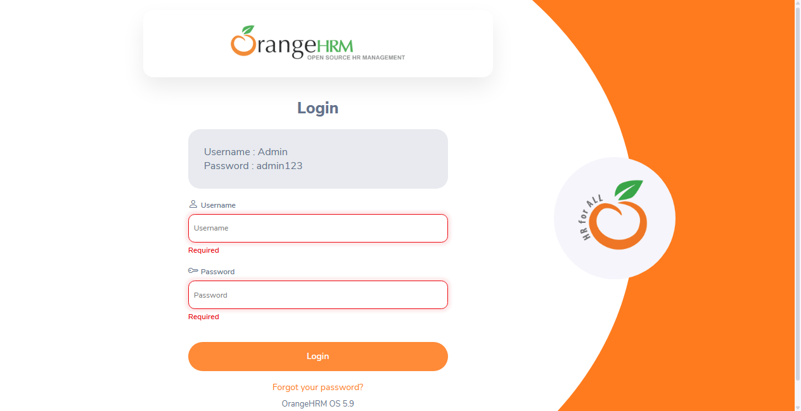

---

### BUG-002. Сесія не завершується після 16 хв бездіяльності — сторінки відкриваються без повторного входу (S-20)

| Поле | Значення |
| :--- | :--- |
| **Bug ID** | BUG-002 — issue [#24](https://github.com/white-cod/Software-Quality-Assurance-Technologies_Stuff-Plus/issues/24) |
| **Severity** | Major |
| **Priority** | P3 |
| **Пов'язані TC / вимога** | TC-008 / S-20 |
| **Автор (Reporter)** | Любочка В. |
| **Дата** | 27.10.2026 |
| **Статус** | Open (New → Open після рецензування) |
| **Рецензент** | Коломоєць О., 28.10.2026 — Чек-лист 7 правил: 7 / 7. Зауваження: (1) додати точний час бездіяльності у «Фактичний результат» — виправлено; (2) автор запропонував Critical, але за 4.12 Critical — це відмова, втрата даних або блокування ключової функції; змінено на Major з обґрунтуванням — виправлено. |

**Опис.** S-20: сесія автоматично завершується після 15 хв бездіяльності, звернення до захищених сторінок без сесії переадресовує на вхід. Після 16 хв без жодних дій клік у меню відкриває модуль без повторного входу.

* *Обґрунтування severity (Major):* Major (4.12) — важлива захисна функція працює не на належному рівні: сесія не завершується після 15 хв, залишений без нагляду комп'ютер HR-фахівця дає сторонньому доступ до персональних даних. Не Critical — відмови, втрати даних чи блокування функцій немає.
* *Обґрунтування priority (P3):* P3 (4.13): дефект не блокує виконання жодного тест-кейсу — через нього немає blocked, решта кейсів Run 1 виконувалась. Рекомендована черговість — перша серед звітів: ризик витоку персональних даних, виправляється налаштуванням терміну сесії.

**Кроки відтворення**

1. Відкрити https://opensource-demo.orangehrmlive.com/web/index.php/auth/login у новому вікні інкогніто Chrome.
2. Увійти як Admin / admin123.
3. У бічному меню натиснути PIM і запустити секундомір.
4. Не виконувати жодних дій у вкладці 16 хв (жодної активності на demo і в інших вкладках).
5. У бічному меню натиснути Leave.

**Фактичний результат.** Відкрито Leave List (https://opensource-demo.orangehrmlive.com/web/index.php/leave/viewLeaveList) під користувачем Admin; сторінку входу не показано. Бездіяльність: 20:46:28 – 21:02:47 (16 хв 19 с).

**Очікуваний результат.** Leave List не відкрито; показано сторінку входу (адреса містить /auth/login) — сесія завершена після 15 хв (S-20).

**Середовище.** Demo OrangeHRM OS 5.9 (https://opensource-demo.orangehrmlive.com), середовище E1 тест-плану; Chrome 155.0.8059.86, Windows 11 Pro 64-bit, вікно інкогніто на весь екран (область сторінки 1920×945); формат дат demo yyyy-dd-mm; дані SETUP-1: працівник Qpivan Testenko, користувач qp.ess.ivan.

**Відтворюваність.** Так: два незалежні сеанси того ж дня — 15:17–15:33 і 20:46–21:02, в обох сесія лишилася активною.

**Вкладення**

* `BUG-002-1.png` 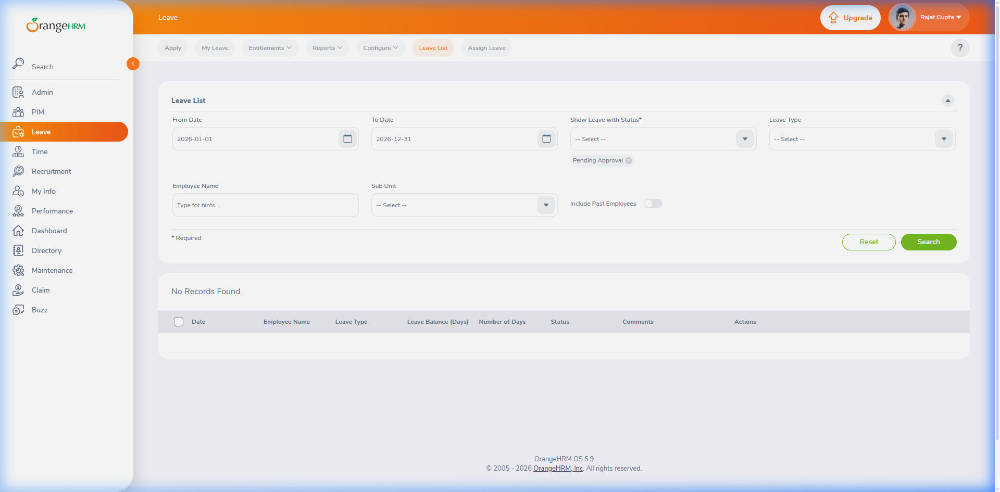

---

### BUG-003. Пароль із 7 символів приймається під час створення користувача — немає «Should have at least 8 characters» (GUI-50, S-10)

| Поле | Значення |
| :--- | :--- |
| **Bug ID** | BUG-003 — issue [#25](https://github.com/white-cod/Software-Quality-Assurance-Technologies_Stuff-Plus/issues/25) |
| **Severity** | Major |
| **Priority** | P3 |
| **Пов'язані TC / вимога** | TC-014 / GUI-50, S-10 |
| **Автор (Reporter)** | Любочка В. |
| **Дата** | 27.10.2026 |
| **Статус** | Open (New → Open після рецензування) |
| **Рецензент** | Коломоєць О., 28.10.2026 — Чек-лист 7 правил: 7 / 7. Питання рецензента: чому три звіти (BUG-003…005), а не один «слабка політика паролів»? Відповідь автора: три окремі правила вимоги з трьома різними повідомленнями, кожне виправляється і перевіряється окремо (правило «один звіт — один дефект»). Прийнято. |

**Опис.** GUI-50 / S-10: пароль — не менше 8 символів, з повідомленням «Should have at least 8 characters» під полем під час введення. Пароль Qpt#st1 (7 символів; велика, мала, цифра, спецсимвол — порушено лише довжину) не викликає повідомлення, і користувача зберігає.

* *Обґрунтування severity (Major):* Major (4.12) — функція перевірки пароля працює неповністю: обліковий запис зі слабшим за S-10 паролем створюється. Не Critical — створення користувача працює, даних не втрачено.
* *Обґрунтування priority (P3):* P3 (4.13): дефект не блокує виконання жодного тест-кейсу — через нього немає blocked, решта кейсів Run 1 виконувалась. Рекомендовано виправити разом із BUG-004 і BUG-005 (одне поле, три правила).

**Кроки відтворення**

1. Відкрити https://opensource-demo.orangehrmlive.com/web/index.php/auth/login у новому вікні інкогніто Chrome.
2. Увійти як Admin / admin123.
3. Admin → «+ Add»: User Role — ESS, Employee Name — Qpivan Testenko, Status — Enabled, Username — qp.pw.check.
4. У поле Password ввести Qpt#st1 (7 символів).
5. У поле Confirm Password ввести Qpt#st1, натиснути Save.

**Фактичний результат.** Крок 4: під полем Password повідомлень немає; праворуч індикатор «Better» і підказка «For a strong password, please use a hard to guess combination of text with upper and lower case characters, symbols and numbers». Крок 5: «Successfully Saved», користувача qp.pw.check створено (видалено після перевірки).

**Очікуваний результат.** Крок 4: під полем Password — «Should have at least 8 characters» (GUI-50, S-10). Крок 5: форма не зберігається.

**Середовище.** Demo OrangeHRM OS 5.9 (https://opensource-demo.orangehrmlive.com), середовище E1 тест-плану; Chrome 155.0.8059.86, Windows 11 Pro 64-bit, вікно інкогніто на весь екран (область сторінки 1920×945); формат дат demo yyyy-dd-mm; дані SETUP-1: працівник Qpivan Testenko, користувач qp.ess.ivan.

**Відтворюваність.** Так: повторне виконання в новому вікні інкогніто.

**Вкладення**

* `BUG-003-1.png` 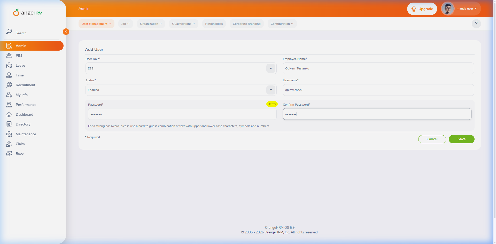

---

### BUG-004. Пароль без великої латинської літери приймається, індикатор показує «Strong» (GUI-50, S-10)

| Поле | Значення |
| :--- | :--- |
| **Bug ID** | BUG-004 — issue [#26](https://github.com/white-cod/Software-Quality-Assurance-Technologies_Stuff-Plus/issues/26) |
| **Severity** | Major |
| **Priority** | P3 |
| **Пов'язані TC / вимога** | TC-015 / GUI-50, S-10 |
| **Автор (Reporter)** | Любочка В. |
| **Дата** | 27.10.2026 |
| **Статус** | Open (New → Open після рецензування) |
| **Рецензент** | Коломоєць О., 28.10.2026 — Чек-лист 7 правил: 7 / 7. Зауважень немає. |

**Опис.** GUI-50 / S-10: пароль містить щонайменше одну велику латинську літеру, при порушенні — «Your password must contain minimum 1 upper-case letter». Пароль qptest#12 (9 символів, без великої літери) приймається.

* *Обґрунтування severity (Major):* Major (4.12) — як BUG-003: правило про велику літеру не перевіряється; індикатор «Strong» додатково вводить адміністратора в оману.
* *Обґрунтування priority (P3):* P3 (4.13): дефект не блокує виконання жодного тест-кейсу — через нього немає blocked, решта кейсів Run 1 виконувалась. Рекомендовано виправити разом із BUG-003 і BUG-005.

**Кроки відтворення**

1. Відкрити https://opensource-demo.orangehrmlive.com/web/index.php/auth/login у новому вікні інкогніто Chrome.
2. Увійти як Admin / admin123.
3. Admin → «+ Add»: User Role — ESS, Employee Name — Qpivan Testenko, Status — Enabled, Username — qp.pw.check.
4. У поле Password ввести qptest#12.
5. У поле Confirm Password ввести qptest#12, натиснути Save.

**Фактичний результат.** Крок 4: під полем Password повідомлень немає; індикатор складності — зелений «Strong». Крок 5: «Successfully Saved», користувача qp.pw.check створено (видалено після перевірки).

**Очікуваний результат.** Крок 4: під полем Password — «Your password must contain minimum 1 upper-case letter» (GUI-50, S-10). Крок 5: форма не зберігається.

**Середовище.** Demo OrangeHRM OS 5.9 (https://opensource-demo.orangehrmlive.com), середовище E1 тест-плану; Chrome 155.0.8059.86, Windows 11 Pro 64-bit, вікно інкогніто на весь екран (область сторінки 1920×945); формат дат demo yyyy-dd-mm; дані SETUP-1: працівник Qpivan Testenko, користувач qp.ess.ivan.

**Відтворюваність.** Так: повторне виконання в новому вікні інкогніто.

**Вкладення**

* `BUG-004-1.png` 

---

### BUG-005. Пароль без спеціального символу приймається під час створення користувача (GUI-50, S-10)

| Поле | Значення |
| :--- | :--- |
| **Bug ID** | BUG-005 — issue [#27](https://github.com/white-cod/Software-Quality-Assurance-Technologies_Stuff-Plus/issues/27) |
| **Severity** | Major |
| **Priority** | P3 |
| **Пов'язані TC / вимога** | TC-016 / GUI-50, S-10 |
| **Автор (Reporter)** | Любочка В. |
| **Дата** | 27.10.2026 |
| **Статус** | Open (New → Open після рецензування) |
| **Рецензент** | Коломоєць О., 28.10.2026 — Чек-лист 7 правил: 7 / 7. Зауважень немає. |

**Опис.** GUI-50 / S-10: пароль містить щонайменше один спеціальний символ, при порушенні — «Your password must contain minimum 1 special character». Пароль Qptest123 (9 символів, без спецсимволу) приймається.

* *Обґрунтування severity (Major):* Major (4.12) — як BUG-003: правило про спецсимвол не перевіряється, пароль за словниковим шаблоном (Qptest123) приймається.
* *Обґрунтування priority (P3):* P3 (4.13): дефект не блокує виконання жодного тест-кейсу — через нього немає blocked, решта кейсів Run 1 виконувалась. Рекомендовано виправити разом із BUG-003 і BUG-004.

**Кроки відтворення**

1. Відкрити https://opensource-demo.orangehrmlive.com/web/index.php/auth/login у новому вікні інкогніто Chrome.
2. Увійти як Admin / admin123.
3. Admin → «+ Add»: User Role — ESS, Employee Name — Qpivan Testenko, Status — Enabled, Username — qp.pw.check.
4. У поле Password ввести Qptest123.
5. У поле Confirm Password ввести Qptest123, натиснути Save.

**Фактичний результат.** Крок 4: під полем Password повідомлень немає; індикатор складності — сірий «Weak». Крок 5: «Successfully Saved», користувача qp.pw.check створено (видалено після перевірки).

**Очікуваний результат.** Крок 4: під полем Password — «Your password must contain minimum 1 special character» (GUI-50, S-10). Крок 5: форма не зберігається.

**Середовище.** Demo OrangeHRM OS 5.9 (https://opensource-demo.orangehrmlive.com), середовище E1 тест-плану; Chrome 155.0.8059.86, Windows 11 Pro 64-bit, вікно інкогніто на весь екран (область сторінки 1920×945); формат дат demo yyyy-dd-mm; дані SETUP-1: працівник Qpivan Testenko, користувач qp.ess.ivan.

**Відтворюваність.** Так: повторне виконання в новому вікні інкогніто.

**Вкладення**

* `BUG-005-1.png` 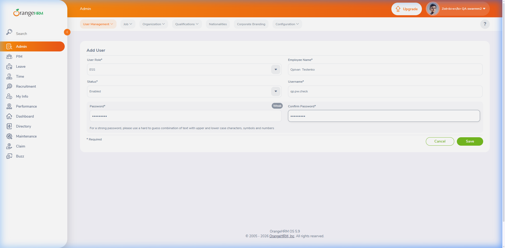

---

### BUG-006. Повідомлення «Success» після збереження з'являється в лівому нижньому куті замість правого (GUI-85)

| Поле | Значення |
| :--- | :--- |
| **Bug ID** | BUG-006 — issue [#28](https://github.com/white-cod/Software-Quality-Assurance-Technologies_Stuff-Plus/issues/28) |
| **Severity** | Trivial |
| **Priority** | P3 |
| **Пов'язані TC / вимога** | TC-021, TC-024 / GUI-85 |
| **Автор (Reporter)** | Мініцька А. |
| **Дата** | 27.10.2026 |
| **Статус** | Open (New → Open після рецензування) |
| **Рецензент** | Коломоєць О., 28.10.2026 — Чек-лист 7 правил: 7 / 7. Зауваження: два кейси з однаковою причиною — один звіт із двома вкладеннями замість двох звітів (дублікат). Виправлено. |

**Опис.** GUI-85: після успішного збереження форми у правому нижньому куті показується зелене спливаюче повідомлення «Success». У двох різних формах (Add Employee і Personal Details) повідомлення показується ліворуч унизу, частково перекриваючи бічне меню.

* *Обґрунтування severity (Trivial):* Trivial (4.12) — косметичний дефект: текст, колір і автоматичне зникнення повідомлення відповідають GUI-85, відрізняється лише кут екрана.
* *Обґрунтування priority (P3):* P3 (4.13): дефект не блокує виконання жодного тест-кейсу — через нього немає blocked, решта кейсів Run 1 виконувалась. Рекомендована черговість — разом з іншими правками інтерфейсу.

**Кроки відтворення**

1. Відкрити https://opensource-demo.orangehrmlive.com/web/index.php/auth/login у новому вікні інкогніто Chrome.
2. Увійти як Admin / admin123.
3. PIM → Add Employee: First Name — Qpanna, Last Name — Dodanenko.
4. Натиснути Save і подивитися на спливаюче повідомлення.
5. Очищення: PIM → знайти Qpanna Dodanenko → видалити.

**Фактичний результат.** Крок 4: зелене «Success / Successfully Saved» у лівому нижньому куті, поверх бічного меню; зникає саме. Те саме в TC-024 для «Successfully Updated» (Personal Details, Save).

**Очікуваний результат.** Крок 4: зелене «Success / Successfully Saved» у правому нижньому куті, зникає без дій користувача (GUI-85).

**Середовище.** Demo OrangeHRM OS 5.9 (https://opensource-demo.orangehrmlive.com), середовище E1 тест-плану; Chrome 155.0.8059.86, Windows 11 Pro 64-bit, вікно інкогніто на весь екран (область сторінки 1920×945); формат дат demo yyyy-dd-mm; дані SETUP-1: працівник Qpivan Testenko, користувач qp.ess.ivan.

**Відтворюваність.** Так: TC-021 повторено в новому вікні; TC-024 — інша форма, той самий результат.

**Вкладення**

* `BUG-006-1.png` 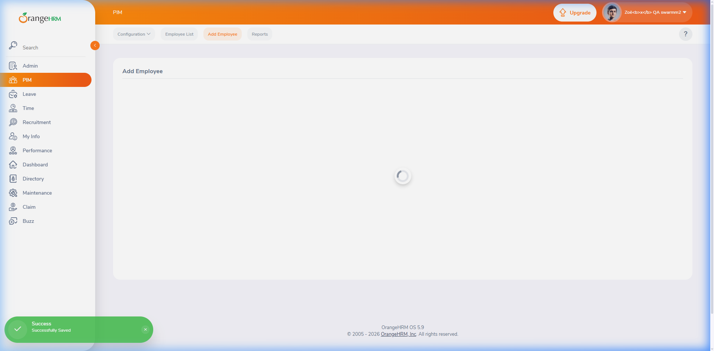
* `BUG-006-2.png` 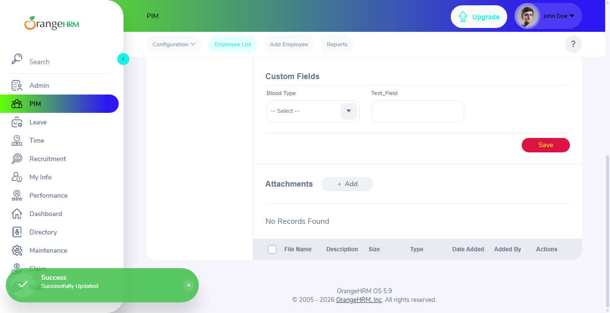

---

### BUG-007. Працівник (ESS) у My Info може редагувати особисті дані Personal Details (F-60)

| Поле | Значення |
| :--- | :--- |
| **Bug ID** | BUG-007 — issue [#29](https://github.com/white-cod/Software-Quality-Assurance-Technologies_Stuff-Plus/issues/29) |
| **Severity** | Major |
| **Priority** | P3 |
| **Пов'язані TC / вимога** | TC-025 / F-60 |
| **Автор (Reporter)** | Мініцька А. |
| **Дата** | 27.10.2026 |
| **Статус** | Open (New → Open після рецензування) |
| **Рецензент** | Коломоєць О., 28.10.2026 — Чек-лист 7 правил: 7 / 7. Зауважень немає. |

**Опис.** F-60: у розділі My Info працівник бачить власний профіль і редагує лише контактні дані. Під ESS-користувачем поля Personal Details доступні для введення, є кнопка Save.

* *Обґрунтування severity (Major):* Major (4.12) — функція розмежування прав працює неповністю: працівник може сам змінити ім'я та інші особисті дані, що є основою кадрових документів. Не Critical — чужі профілі не зачіпаються, функцій не заблоковано.
* *Обґрунтування priority (P3):* P3 (4.13): дефект не блокує виконання жодного тест-кейсу — через нього немає blocked, решта кейсів Run 1 виконувалась. Рекомендована черговість — висока серед P3: ризик для цілісності кадрових даних, виправляється налаштуванням прав ролі ESS.

**Кроки відтворення**

1. Відкрити https://opensource-demo.orangehrmlive.com/web/index.php/auth/login у новому вікні інкогніто Chrome.
2. Увійти як qp.ess.ivan / QpTest#2026 (ESS-користувач працівника Qpivan Testenko, створений процедурою SETUP-1).
3. У бічному меню натиснути My Info (відкрито Personal Details власного профілю).
4. Клікнути в поле First Name і ввести X (без збереження).

**Фактичний результат.** Крок 4: поле First Name доступне для введення — у полі «QpivanX»; поля Middle Name, Last Name, Other Id, Nationality, Marital Status також активні (без сірого фону); у блоці Personal Details є активна кнопка Save. Недоступні (сірі) лише Employee Id, Driver's License Number і Date of Birth. Зміни не зберігались (етика 5.4).

**Очікуваний результат.** Крок 4: поля Personal Details лише для перегляду, кнопки Save немає; редагуються лише контактні дані (F-60).

**Середовище.** Demo OrangeHRM OS 5.9 (https://opensource-demo.orangehrmlive.com), середовище E1 тест-плану; Chrome 155.0.8059.86, Windows 11 Pro 64-bit, вікно інкогніто на весь екран (область сторінки 1920×945); формат дат demo yyyy-dd-mm; дані SETUP-1: працівник Qpivan Testenko, користувач qp.ess.ivan.

**Відтворюваність.** Так: повторне виконання в новому вікні інкогніто.

**Вкладення**

* `BUG-007-1.png` 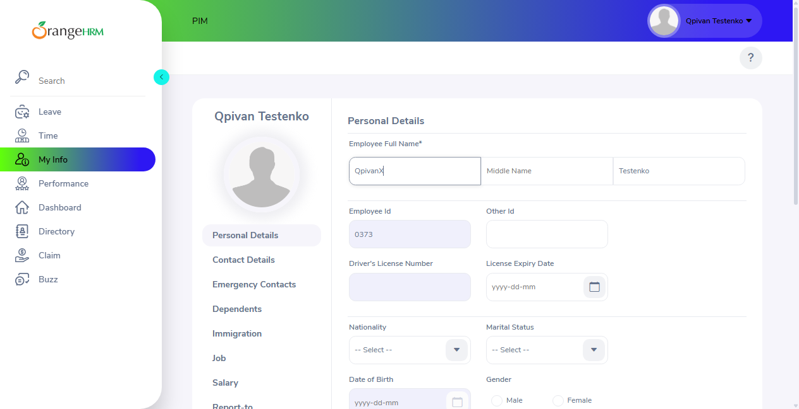

---

### BUG-008. 95-й перцентиль часу відкриття сторінок — 6,48 с при нормі 3 с (P-10)

| Поле | Значення |
| :--- | :--- |
| **Bug ID** | BUG-008 — issue [#31](https://github.com/white-cod/Software-Quality-Assurance-Technologies_Stuff-Plus/issues/31) |
| **Severity** | Normal |
| **Priority** | P3 |
| **Пов'язані TC / вимога** | TC-026 / P-10 |
| **Автор (Reporter)** | Шпилька Т. |
| **Дата** | 27.10.2026 |
| **Статус** | Open (New → Open після рецензування) |
| **Рецензент** | Коломоєць О., 28.10.2026 — Чек-лист 7 правил: 7 / 7. Зауваження: (1) зазначити відхилення від кейсу (сторінка Admin замість Recruitment) і показати, що висновок від нього не залежить — виправлено; (2) швидкість каналу на fast.com перед замірами не записана — виміряно 28.10.2026 з того самого підключення (910 Мбіт/с), у журналі зазначено як відхилення від передумов; для Run 2 додано в чек-лист виконавця — виправлено. |

**Опис.** P-10: сторінки модулів відкриваються не довше ніж за 3 с (95-й перцентиль). Виміряно 20 значень Finish (DevTools → Network, Disable cache, без throttling): 5 переходів на кожну з 4 сторінок; канал — 910 Мбіт/с (fast.com, виміряно 28.10.2026 з того самого підключення). Відхилення від кейсу: четвертою сторінкою виміряно Admin → User Management замість Recruitment → Vacancies; без неї (15 значень трьох сторінок кейсу) перевищення 3 с — у 7 замірах, висновок не змінюється.

* *Обґрунтування severity (Normal):* Normal (4.12) — користуватися можна, але з незручністю: половина замірів (10 з 20) довша за 3 с, максимум 6,59 с; функції працюють.
* *Обґрунтування priority (P3):* P3 (4.13): дефект не блокує виконання жодного тест-кейсу — через нього немає blocked, решта кейсів Run 1 виконувалась. Перед виправленням результат слід підтвердити на ізольованому стенді E2 (локальний Docker, тест-план, розд. 5): demo — спільний публічний стенд із невідомим навантаженням.

**Кроки відтворення**

1. Відкрити https://opensource-demo.orangehrmlive.com/web/index.php/auth/login у новому вікні інкогніто Chrome.
2. Увійти як Admin / admin123.
3. Відкрити DevTools (F12) → Network; увімкнути Disable cache, throttling — No throttling.
4. По черзі відкривати сторінки PIM (Employee List), Leave (Leave List), Time (Timesheets), Admin (User Management) — 5 кругів; після кожного переходу записати значення Finish у рядку стану Network.
5. Упорядкувати 20 значень і взяти 19-те (95-й перцентиль).

**Фактичний результат.** PIM: 6,48 · 3,08 · 2,24 · 2,50 · 6,59 с; Leave: 4,46 · 2,39 · 2,36 · 3,26 · 4,33 с; Time: 2,43 · 2,23 · 2,29 · 5,50 · 3,96 с; Admin: 2,27 · 2,21 · 2,22 · 6,02 · 4,80 с. 95-й перцентиль (19-те з 20) = 6,48 с; 10 з 20 значень > 3 с.

**Очікуваний результат.** 95-й перцентиль ≤ 3,0 с (P-10).

**Середовище.** Demo OrangeHRM OS 5.9 (https://opensource-demo.orangehrmlive.com), середовище E1 тест-плану; Chrome 155.0.8059.86, Windows 11 Pro 64-bit, вікно інкогніто на весь екран (область сторінки 1920×945); формат дат demo yyyy-dd-mm; дані SETUP-1: працівник Qpivan Testenko, користувач qp.ess.ivan.

**Відтворюваність.** Перевищення стабільне: 5 кругів по 4 сторінки, перевищення є в кожній із чотирьох сторінок.

**Вкладення**

* `BUG-008-1.png` 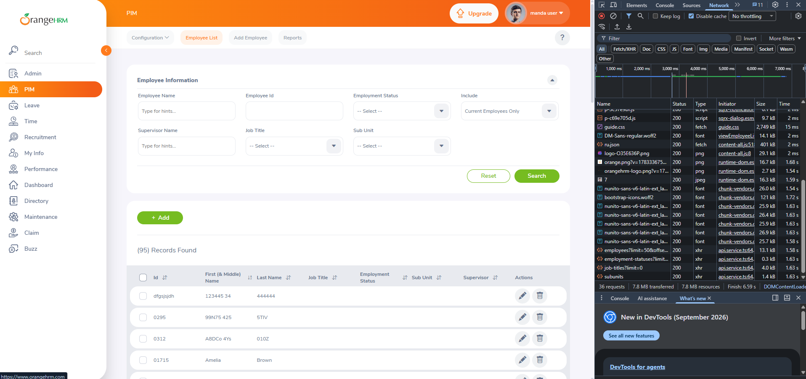
* `BUG-008-2.png` 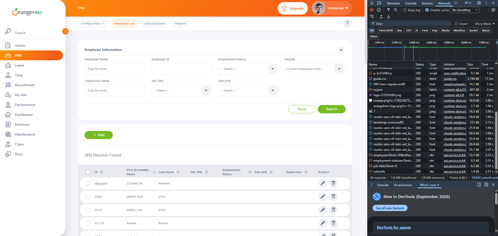

---

### BUG-009. Державні свята віднімаються з тривалості заявки: 09–13.11.2026 рахується як 3.00 дні замість 5.00 (BL-30, F-70)

| Поле | Значення |
| :--- | :--- |
| **Bug ID** | BUG-009 — issue [#32](https://github.com/white-cod/Software-Quality-Assurance-Technologies_Stuff-Plus/issues/32) |
| **Severity** | Major |
| **Priority** | P3 |
| **Пов'язані TC / вимога** | TC-031 / BL-30, F-70 |
| **Автор (Reporter)** | Любочка В. |
| **Дата** | 27.10.2026 |
| **Статус** | Open (New → Open після рецензування) |
| **Рецензент** | Коломоєць О., 28.10.2026 — Чек-лист 7 правил: 7 / 7. Зауваження: послатися на відкрите питання замовнику в обґрунтуванні пріоритету — виправлено. |

**Опис.** BL-30: тривалість — кількість робочих днів включно з обома датами; суботи й неділі не враховуються, святкові дні не виокремлюються. Заявка пн 09.11 – пт 13.11.2026 охоплює свята demo 11.11 (Remembrance Day) і 12.11 (Veterans Day) і має тривати 5 днів.

* *Обґрунтування severity (Major):* Major (4.12) — важлива функція працює неповністю: тривалість заявки, а отже і списання з балансу, розраховується не за BL-30 для будь-якого періоду зі святами (пор. приклад 4.12 «Персонал+» щодо заявок на відпустку).
* *Обґрунтування priority (P3):* P3 (4.13): дефект не блокує виконання жодного тест-кейсу — через нього немає blocked, решта кейсів Run 1 виконувалась. Відкрите питання замовнику № 1 зі спринта 2 («чи вилучати державні свята?»): якщо замовник підтвердить вилучення, виправляється SRS (BL-30), а не продукт.

**Кроки відтворення**

1. Відкрити https://opensource-demo.orangehrmlive.com/web/index.php/auth/login у новому вікні інкогніто Chrome.
2. Увійти як qp.ess.ivan / QpTest#2026 (ESS-користувач працівника Qpivan Testenko, створений процедурою SETUP-1).
3. Leave → Apply: Leave Type — US - Vacation (баланс 5.00 Day(s)).
4. From Date — 2026-09-11, To Date — 2026-13-11 (формат yyyy-dd-mm); Comments — QP TC-031; Apply.
5. Leave → My Leave: знайти рядок заявки.
6. Очищення: Cancel у рядку заявки.

**Фактичний результат.** Крок 5: рядок «2026-09-11 to 2026-13-11», Number of Days 3.00, статус Pending Approval (3.00), Leave Balance 2.00.

**Очікуваний результат.** Крок 5: Number of Days 5.00, статус Pending Approval (5.00) — свята не виокремлюються (BL-30).

**Середовище.** Demo OrangeHRM OS 5.9 (https://opensource-demo.orangehrmlive.com), середовище E1 тест-плану; Chrome 155.0.8059.86, Windows 11 Pro 64-bit, вікно інкогніто на весь екран (область сторінки 1920×945); формат дат demo yyyy-dd-mm; дані SETUP-1: працівник Qpivan Testenko, користувач qp.ess.ivan.

**Відтворюваність.** Так: повторне виконання; той самий результат у двох окремих проходах.

**Вкладення**

* `BUG-009-1.png` 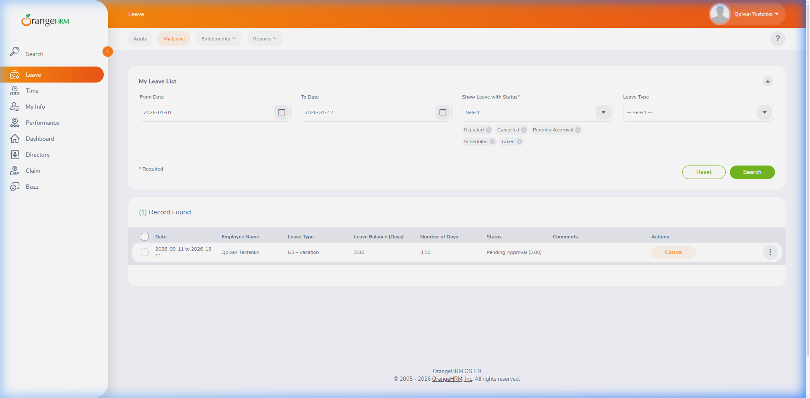

---

### BUG-010. У режимі редагування табеля немає стовпця Total і підсумкового рядка — підсумки не оновлюються після виходу з комірки (GUI-80)

| Поле | Значення |
| :--- | :--- |
| **Bug ID** | BUG-010 — issue [#33](https://github.com/white-cod/Software-Quality-Assurance-Technologies_Stuff-Plus/issues/33) |
| **Severity** | Normal |
| **Priority** | P3 |
| **Пов'язані TC / вимога** | TC-042 / GUI-80 |
| **Автор (Reporter)** | Шпилька Т. |
| **Дата** | 27.10.2026 |
| **Статус** | Open (New → Open після рецензування) |
| **Рецензент** | Коломоєць О., 28.10.2026 — Чек-лист 7 правил: 7 / 7. Зауважень немає. |

**Опис.** GUI-80: табель — таблиця з Project, Activity, стовпцем на кожен день і Total; підсумковий стовпець і рядок оновлюються після виходу з відредагованої комірки без Save і без перезавантаження.

* *Обґрунтування severity (Normal):* Normal (4.12) — користуватися можна, але незручно: підсумки видно лише після Save на сторінці перегляду (пор. приклад 4.12 про лічильник, що оновлюється лише після перезавантаження).
* *Обґрунтування priority (P3):* P3 (4.13): дефект не блокує виконання жодного тест-кейсу — через нього немає blocked, решта кейсів Run 1 виконувалась. Рекомендована черговість — планова, обхід є (зберегти й переглянути).

**Кроки відтворення**

1. Відкрити https://opensource-demo.orangehrmlive.com/web/index.php/auth/login у новому вікні інкогніто Chrome.
2. Увійти як qp.ess.ivan / QpTest#2026 (ESS-користувач працівника Qpivan Testenko, створений процедурою SETUP-1).
3. Time → My Timesheets: Timesheet Period — 2026-12-10 – 2026-18-10; Create Timesheet; Edit.
4. У першому рядку обрати ACME Ltd / Bug Fixes; у стовпці понеділка ввести 8, натиснути Tab.
5. У стовпці вівторка ввести 4.5, натиснути Tab.
6. Cancel.

**Фактичний результат.** Крок 3: таблиця Edit Timesheet містить Project, Activity, 7 днів (12 Mon … 18 Sun) і кнопку видалення рядка; стовпця Total і підсумкового рядка немає. Кроки 4–5: після Tab жодних підсумків на сторінці не з'являється.

**Очікуваний результат.** Крок 3: є стовпець Total; крок 4: Total рядка = 8.00, підсумок понеділка = 8.00; крок 5: Total = 12.50 (GUI-80).

**Середовище.** Demo OrangeHRM OS 5.9 (https://opensource-demo.orangehrmlive.com), середовище E1 тест-плану; Chrome 155.0.8059.86, Windows 11 Pro 64-bit, вікно інкогніто на весь екран (область сторінки 1920×945); формат дат demo yyyy-dd-mm; дані SETUP-1: працівник Qpivan Testenko, користувач qp.ess.ivan.

**Відтворюваність.** Так: повторне виконання в новому вікні інкогніто.

**Вкладення**

* `BUG-010-1.png` 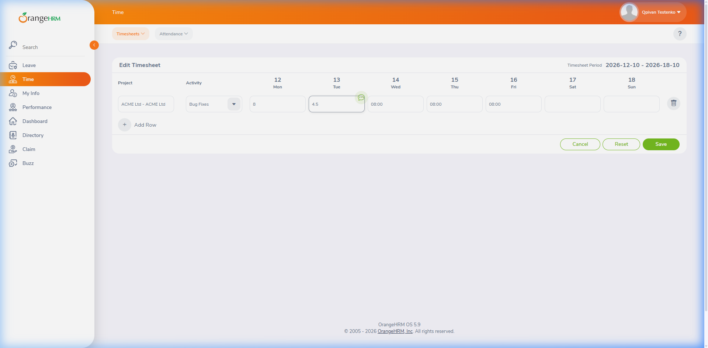

---

### BUG-011. Email кандидата з однолітерною доменною зоною (qp.kand@example.c) приймається і зберігається (BL-80, F-140)

| Поле | Значення |
| :--- | :--- |
| **Bug ID** | BUG-011 — issue [#34](https://github.com/white-cod/Software-Quality-Assurance-Technologies_Stuff-Plus/issues/34) |
| **Severity** | Minor |
| **Priority** | P3 |
| **Пов'язані TC / вимога** | TC-048 / BL-80, F-140 |
| **Автор (Reporter)** | Шпилька Т. |
| **Дата** | 27.10.2026 |
| **Статус** | Open (New → Open після рецензування) |
| **Рецензент** | Коломоєць О., 28.10.2026 — Чек-лист 7 правил: 7 / 7. Зауважень немає. |

**Опис.** BL-80: зона email — щонайменше 2 латинські літери; формат перевіряється, інакше «Expected format: admin@example.com». Адреса з зоною з 1 літери приймається.

* *Обґрунтування severity (Minor):* Minor (4.12) — незначна втрата функціональності: некоректна адреса потрапляє в базу, але рекрутер може її виправити; ситуація рідкісна (одруківка в зоні).
* *Обґрунтування priority (P3):* P3 (4.13): дефект не блокує виконання жодного тест-кейсу — через нього немає blocked, решта кейсів Run 1 виконувалась. Рекомендована черговість — планова.

**Кроки відтворення**

1. Відкрити https://opensource-demo.orangehrmlive.com/web/index.php/auth/login у новому вікні інкогніто Chrome.
2. Увійти як Admin / admin123.
3. Recruitment → Candidates → «+ Add»: First Name — Qpmail, Last Name — Kandydatenko.
4. У поле Email ввести qp.kand@example.c.
5. Натиснути Save.
6. Очищення: видалити кандидата Qpmail Kandydatenko.

**Фактичний результат.** Крок 4: під полем Email повідомлень немає. Крок 5: «Successfully Saved», відкрито картку кандидата Qpmail Kandydatenko з адресою qp.kand@example.c.

**Очікуваний результат.** Крок 4: під полем Email — «Expected format: admin@example.com»; крок 5: кандидата не збережено (BL-80). Межа: зона з 2 літер (qp.kand@example.ua) приймається — TC-049 passed.

**Середовище.** Demo OrangeHRM OS 5.9 (https://opensource-demo.orangehrmlive.com), середовище E1 тест-плану; Chrome 155.0.8059.86, Windows 11 Pro 64-bit, вікно інкогніто на весь екран (область сторінки 1920×945); формат дат demo yyyy-dd-mm; дані SETUP-1: працівник Qpivan Testenko, користувач qp.ess.ivan.

**Відтворюваність.** Так: повторне виконання в новому вікні інкогніто.

**Вкладення**

* `BUG-011-1.png` 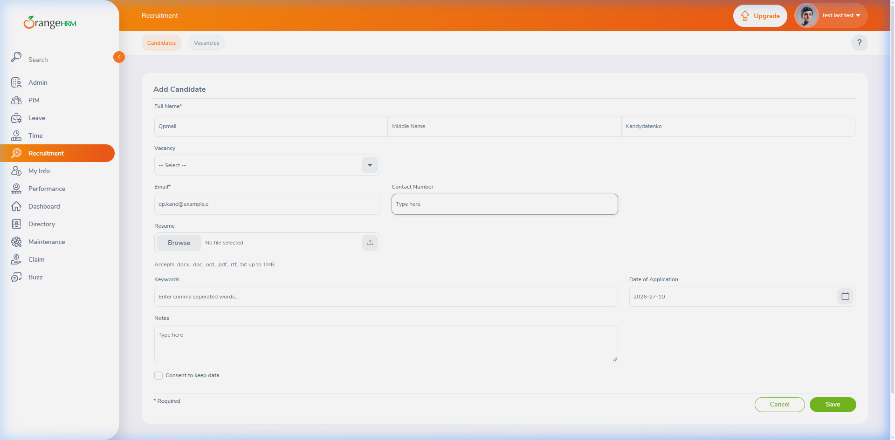

---

### BUG-012. Довідка «?» відкриває англомовний OrangeHRM Starter Help Center замість довідки українською (D-10)

| Поле | Значення |
| :--- | :--- |
| **Bug ID** | BUG-012 — issue [#35](https://github.com/white-cod/Software-Quality-Assurance-Technologies_Stuff-Plus/issues/35) |
| **Severity** | Minor |
| **Priority** | P3 |
| **Пов'язані TC / вимога** | TC-050 / D-10 |
| **Автор (Reporter)** | Шпилька Т. |
| **Дата** | 27.10.2026 |
| **Статус** | Open (New → Open після рецензування) |
| **Рецензент** | Коломоєць О., 28.10.2026 — Чек-лист 7 правил: 7 / 7. Зауважень немає. |

**Опис.** D-10: користувацька довідка оформлюється українською; інструкція функції містить ID вимоги, роль, передумови, нумеровані кроки і очікуваний результат. Іконка «?» відкриває зовнішній англомовний портал.

* *Обґрунтування severity (Minor):* Minor (4.12) — проблема зручності: функції системи не порушено, але користувачам без англійської важче навчатися. Вимога D-10 має пріоритет Low.
* *Обґрунтування priority (P3):* P3 (4.13): дефект не блокує виконання жодного тест-кейсу — через нього немає blocked, решта кейсів Run 1 виконувалась. Виправлення потребує підготовки документа довідки (D-10, D-20) — планується окремо.

**Кроки відтворення**

1. Відкрити https://opensource-demo.orangehrmlive.com/web/index.php/auth/login у новому вікні інкогніто Chrome.
2. Увійти як Admin / admin123.
3. У бічному меню натиснути PIM.
4. Натиснути іконку «?» у верхній панелі.

**Фактичний результат.** Крок 4: у новій вкладці відкрито https://starterhelp.orangehrm.com/hc/en-us — портал OrangeHRM Starter англійською; інструкцій зі структурою D-10 (ID вимоги, роль, передумови, кроки, очікуваний результат) немає.

**Очікуваний результат.** Крок 4: відкрито довідку українською; інструкція функції має структуру D-10.

**Середовище.** Demo OrangeHRM OS 5.9 (https://opensource-demo.orangehrmlive.com), середовище E1 тест-плану; Chrome 155.0.8059.86, Windows 11 Pro 64-bit, вікно інкогніто на весь екран (область сторінки 1920×945); формат дат demo yyyy-dd-mm; дані SETUP-1: працівник Qpivan Testenko, користувач qp.ess.ivan.

**Відтворюваність.** Так: повторне виконання; у проході 1 зі сторінки Leave відкривається англомовна стаття того ж порталу.

**Вкладення**

* `BUG-012-1.png` 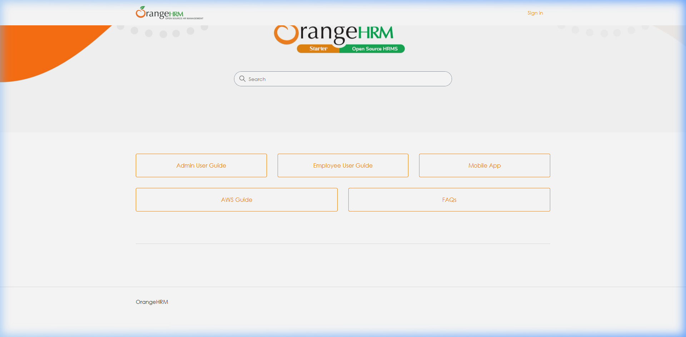

---
